# Templates de post

Esqueletos visuais dos posts de reflexão da Morada. Todos são **post único** (um slide) em **1080×1350 (4:5)**, o formato padrão do feed. A marca
(paleta, fontes, assinatura, voz) está em [`../BRAND.md`](../BRAND.md); cada template descreve só a
composição dele.

Previews: `previews/<id>/slide-01.png` (regerar com
`node instagram-posts/scripts/export.mjs --templates [id]`).

## Catálogo

| ID | Nome | Quando usar | Formato | Imagem |
|---|---|---|---|---|
| `foto-plena` | Foto plena | Frase de consolo sobre uma foto que ocupa o slide inteiro | 1080×1350 | Exige foto |
| `arco` | Janela em arco | Frase doutrinária serena; foto da casa ou da natureza vista por uma janela | 1080×1350 | Exige foto |
| `faixa-azul` | Faixa azul | Frase curta e firme, máxima leitura, sem foto | 1080×1350 | Não usa (ondas desenhadas) |
| `colagem` | Colagem | Frase de afeto; foto impressa com cartão sobreposto | 1080×1350 | Exige foto |
| `dividido` | Meio a meio | Frase que pede contexto (pergunta + resposta), foto e texto lado a lado | 1080×1350 | Exige foto vertical |
| `palavra` | Palavra do dia | Uma palavra-tema enorme, preenchida pela foto, + frase de apoio | 1080×1350 | Foto como textura |
| `pagina` | Página de livro | Trecho mais longo, citado como página impressa | 1080×1350 | Foto como prancha |
| `duotone` | Duotone azul | Frase universal sobre qualquer foto, tingida no azul da casa | 1080×1350 | Exige foto (qualquer) |
| `horizonte` | Horizonte | Frase de recomeço com faixa fotográfica panorâmica de borda a borda | 1080×1350 | Exige foto horizontal |
| `mosaico` | Mosaico | Grade 2×2: três fotos e uma célula azul com a frase | 1080×1350 | Exige três fotos |
| `pergunta` | Pergunta | Uma pergunta enorme e a resposta embaixo, em fundo azul-claro | 1080×1350 | Foto pequena opcional |
| `lua` | Lua | Fundo escuro com foto em círculo saindo pelo canto; noite e oração | 1080×1350 | Exige foto |
| `versos` | Versos | Prece ou texto em versos centralizados, um por linha | 1080×1350 | Foto pequena opcional |
| `vidro` | Vidro | Foto com cor natural e a frase numa faixa branca translúcida com efeito vidro fosco | 1080×1350 | Exige foto com detalhe |

## Galeria

| `foto-plena` | `arco` | `faixa-azul` | `colagem` |
|---|---|---|---|
|  | 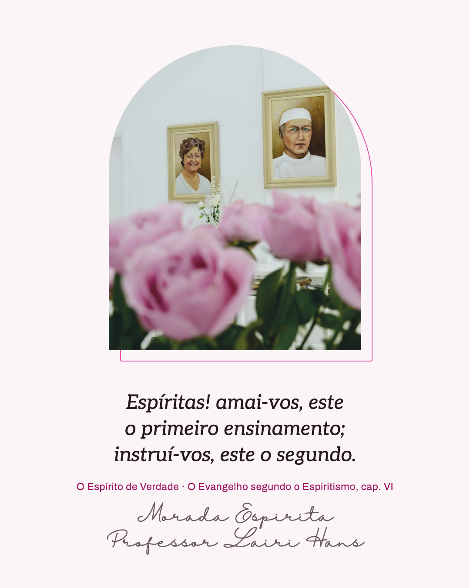 | 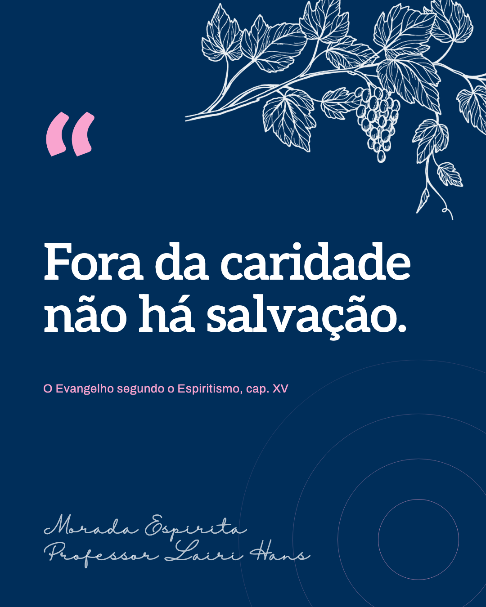 | 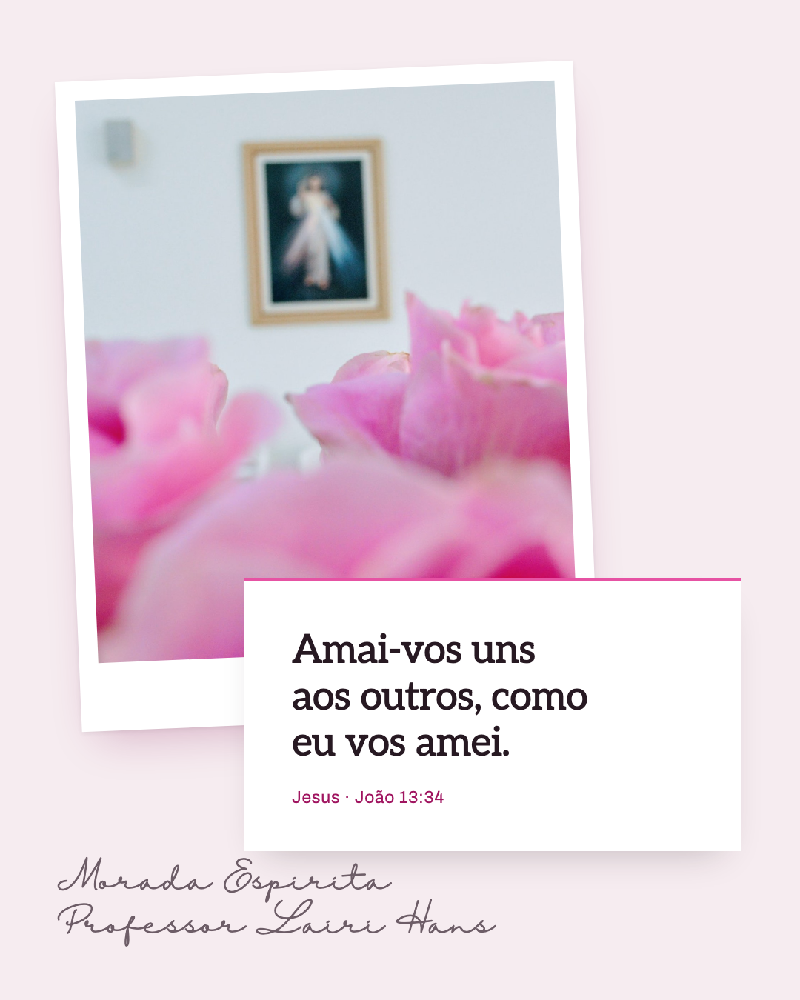 |

| `dividido` | `palavra` | `pagina` | `duotone` |
|---|---|---|---|
| 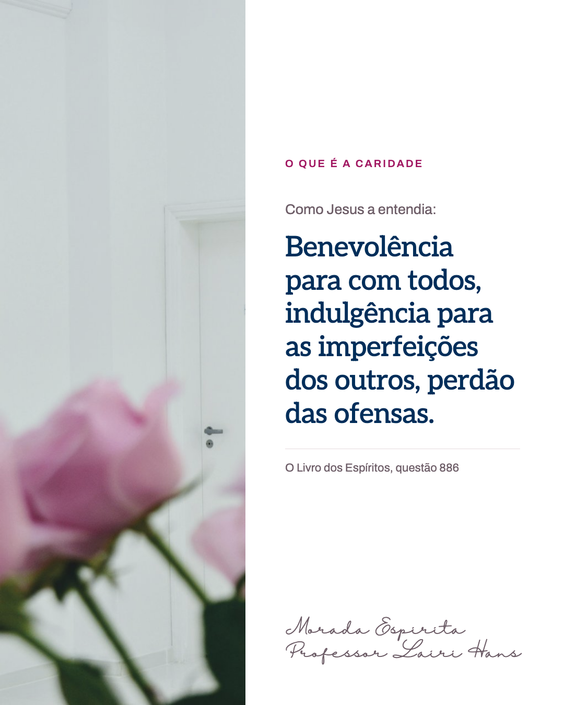 | 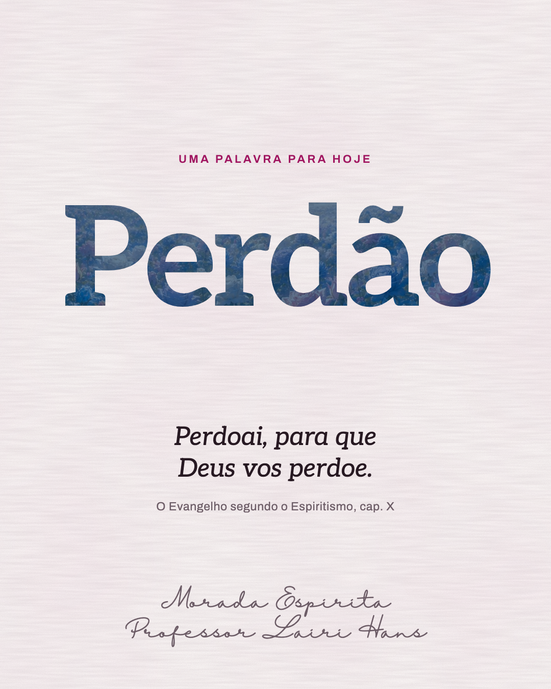 | 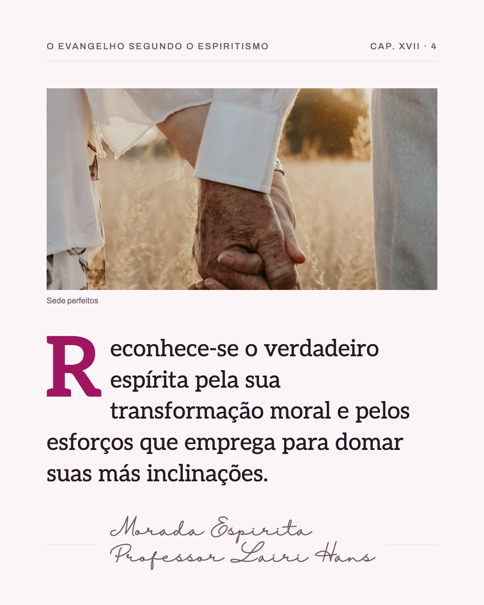 | 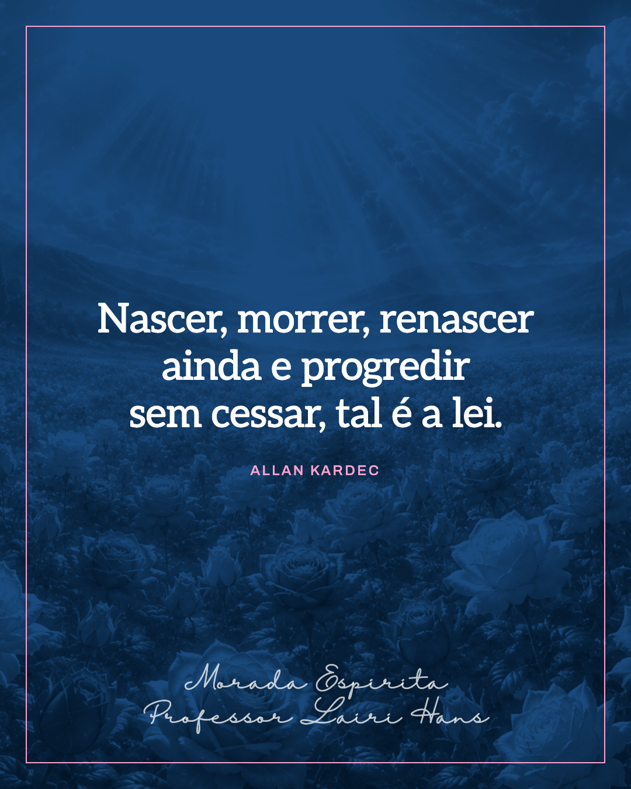 |

| `horizonte` | `mosaico` | `pergunta` | `lua` |
|---|---|---|---|
| 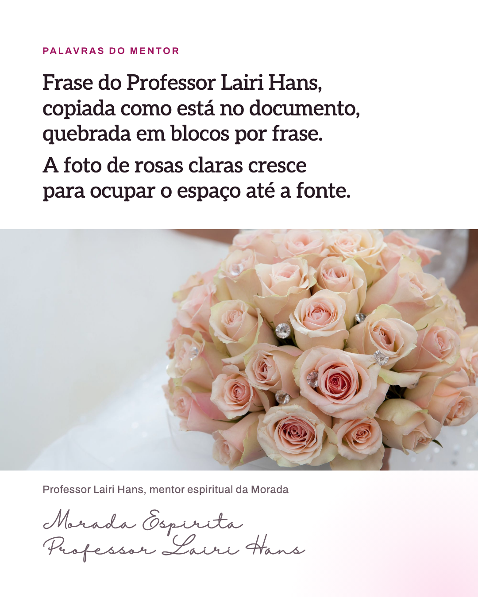 | 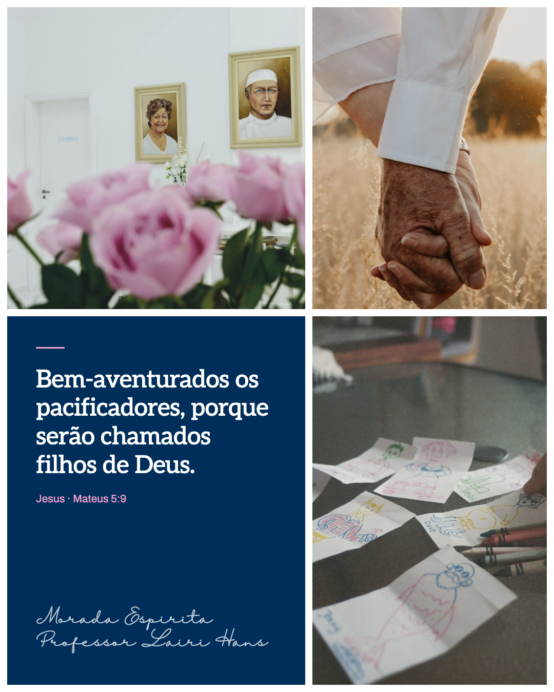 | 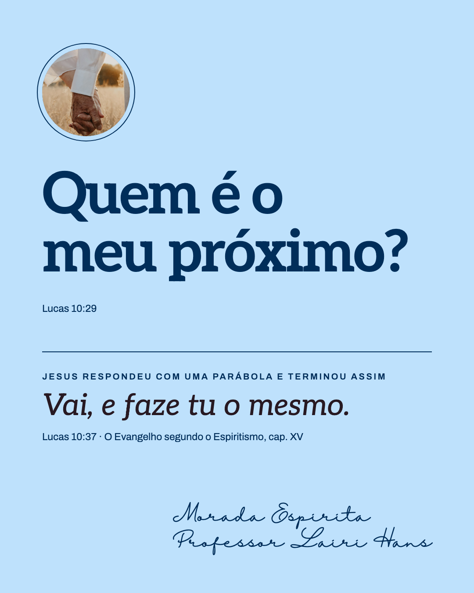 | 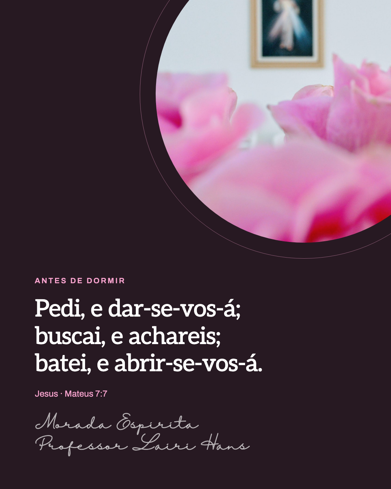 |

| `versos` | `vidro` | | |
|---|---|---|---|
| 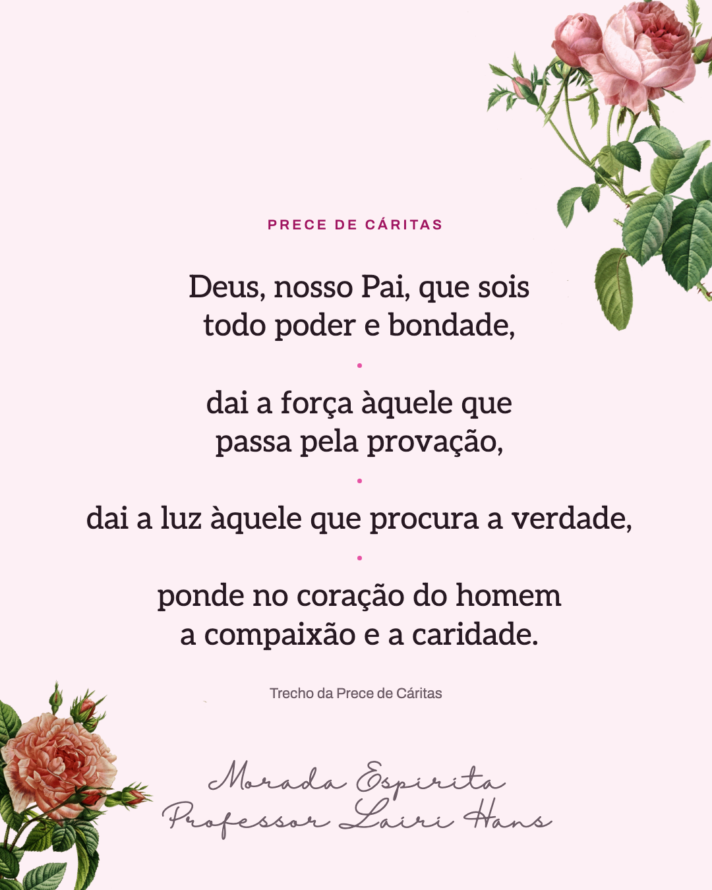 | 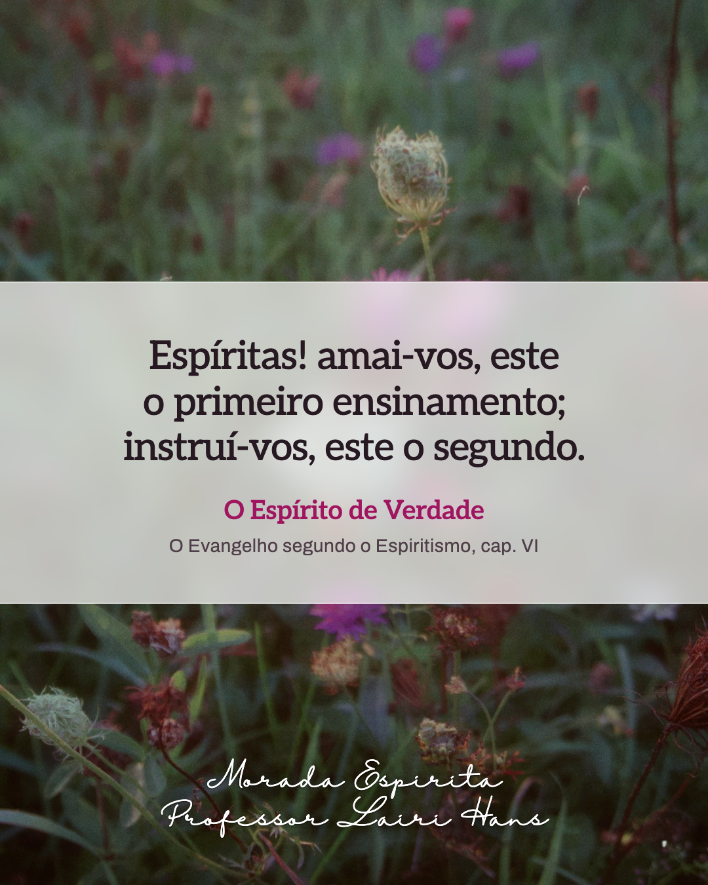 | | |

## Sugestão automática

| Sinal no pedido | Template sugerido |
|---|---|
| consolo, luto, dor, saudade, "para quem está sofrendo" | `foto-plena` |
| ensinamento, doutrina, Espírito de Verdade, a casa por dentro | `arco` |
| frase com até ~8 palavras, máxima/lema, caridade | `faixa-azul` |
| amor, família, amizade, afeto | `colagem` |
| "o que é…", definição, pergunta de O Livro dos Espíritos | `dividido` |
| um conceito em uma palavra (perdão, paciência, fé, gratidão) | `palavra` |
| trecho com mais de ~25 palavras, citação com capítulo e item | `pagina` |
| reencarnação, lei, progresso; foto colorida demais ou de qualidade irregular | `duotone` |
| recomeço, caminho, renovação; foto de paisagem/horizontal | `horizonte` |
| fraternidade, convivência, a casa e as pessoas; três fotos disponíveis | `mosaico` |
| o texto é ou parte de uma pergunta ("Quem é…?", "Qual é…?") | `pergunta` |
| noite, oração, silêncio, "antes de dormir" | `lua` |
| prece, Pai Nosso, Prece de Cáritas, texto com cadência em 3–5 partes | `versos` |
| foto colorida que não deve ser tingida (flores, campo, borboletas); frase curta ou média | `vidro` |

**Ritmo de feed:** não repetir o mesmo template em dois posts seguidos; alternar fundo claro
(`arco`, `colagem`, `dividido`, `palavra`, `pagina`, `horizonte`, `pergunta`, `versos`, `vidro`) com escuro
(`foto-plena`, `faixa-azul`, `duotone`, `lua`, `mosaico`), e foto cheia com composição tipográfica.
